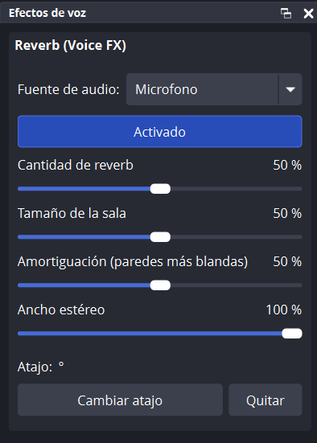

# OBS Voice FX

[English](README.md) | **Español**

Plugin para **OBS Studio** que agrega efectos a tu voz, empezando por la **reverb**. Cada efecto se prende y se apaga con un atajo de teclado o desde su propio panel. El efecto se escucha **solo en lo que sale de OBS** (stream y grabación). En tu micrófono, Discord o el resto de la PC no cambia nada.

<p align="center">
  
</p>

## Características

- **Reverb** con cantidad, tamaño de la sala, amortiguación y ancho estéreo.
- **Panel "Efectos de voz"** que se acomoda en la ventana de OBS como cualquier otro panel. Desde ahí elegís la fuente de audio, prendés o apagás el efecto, movés los deslizadores y asignás el atajo.
- **Atajo de teclado** para activar o desactivar cada efecto. También aparece en *Ajustes → Atajos* de OBS.
- **Tu voz no cambia de volumen**: el efecto se suma *por debajo* de la voz, nunca la reemplaza ni la baja.
- **Si algo falla, la voz pasa igual**: ante cualquier error del efecto, el plugin deja pasar tu voz original. Nunca hay silencio ni ruido.
- Sin conexión a internet y sin telemetría.

## Requisitos

| | |
|---|---|
| Sistema | Windows 10 u 11 de 64 bits |
| OBS Studio | 33.x (probado en **OBS 33.0.1**, Windows 11 de 64 bits) |

## Instalación

> **Guía paso a paso en PDF, con capturas:** [Español](https://github.com/Aetther/obs-voice-fx/releases/latest/download/OBS-Voice-FX-Guia-de-instalacion.pdf) · [English](https://github.com/Aetther/obs-voice-fx/releases/latest/download/OBS-Voice-FX-Installation-Guide-EN.pdf)

1. Descargá **`obs-voice-fx-0.1.0-windows-x64.zip`** desde la sección [**Releases**](https://github.com/Aetther/obs-voice-fx/releases) del repositorio.
   > No uses el botón verde **Code → Download ZIP**: eso baja el código fuente, no el plugin listo para usar.
2. **Cerrá OBS.**
3. Instalalo de una de estas dos formas.

### Opción A: con un comando (recomendada)

Abrí **PowerShell como administrador**: clic derecho en el botón Inicio → *Terminal (Administrador)*. Pegá este comando, que toma el zip de tu carpeta **Descargas** y lo instala en OBS:

```powershell
Expand-Archive -Force -Path "$env:USERPROFILE\Downloads\obs-voice-fx-0.1.0-windows-x64.zip" -DestinationPath "$env:ProgramData\obs-studio\plugins"
```

Si guardaste el zip en otra carpeta, reemplazá la ruta después de `-Path`. Podés copiar la ruta del archivo con Shift + clic derecho → *Copiar como ruta de acceso*.

### Opción B: con el Explorador de archivos

1. Abrí el zip y copiá la carpeta **`obs-voice-fx`** que tiene adentro.
2. En la barra de direcciones del Explorador escribí `C:\ProgramData\obs-studio\plugins` y presioná Enter. Si la carpeta `plugins` no existe, creala.
3. Pegá ahí la carpeta. Windows te va a pedir permiso de administrador: aceptá con *Continuar*.

Con cualquiera de las dos opciones tiene que quedar así:

```
C:\ProgramData\obs-studio\plugins\obs-voice-fx\obs-voice-fx.dll
C:\ProgramData\obs-studio\plugins\obs-voice-fx\LICENSE
C:\ProgramData\obs-studio\plugins\obs-voice-fx\data\...
```

### Verificar la descarga (opcional)

Cada release publica la huella **SHA-256** del zip. Para confirmar que el archivo que bajaste es el original:

```powershell
Get-FileHash "$env:USERPROFILE\Downloads\obs-voice-fx-0.1.0-windows-x64.zip"
```

El número que aparece tiene que ser igual al del release.

### Comprobar que se instaló

Abrí OBS y fijate en **Herramientas → Gestor de plugins**: tiene que aparecer **OBS Voice FX** con su versión.

## Uso

1. Abrí el panel desde el menú **Paneles → Efectos de voz**. Arrastralo a donde te quede cómodo.
2. En **Fuente de audio** elegí tu micrófono.
3. Presioná **Desactivado** para prenderlo: cambia a **Activado**.
4. Ajustá los deslizadores mientras hablás.
5. Presioná **Cambiar atajo**, apretá la combinación que quieras (por ejemplo `Ctrl + Shift + R`) y listo.

### Opciones del panel

| Opción | Qué hace |
|---|---|
| **Fuente de audio** | Fuente donde se aplica el efecto. Solo aparecen fuentes que producen sonido. Si elegís otra, el efecto **se mueve** con la misma configuración. *(ninguna)* lo quita de todas las fuentes. |
| **Activado / Desactivado** | Prende o apaga el efecto. Es lo mismo que el ojito en la ventana de **Filtros** de la fuente. Apagado, tu voz sale exactamente igual que sin el plugin. |
| **Cantidad de reverb** | Cuánto eco se suma a tu voz. 0 % = nada. Para stream suele ir bien entre 15 y 30 %. Tu voz mantiene siempre el mismo volumen. |
| **Tamaño de la sala** | Cuánto dura el eco: bajo = habitación chica, alto = salón grande o iglesia. |
| **Amortiguación** | Cuánto brillo pierde el eco: alta = cálido (cortinas, alfombra), baja = brillante y metálico (baño con azulejos). |
| **Ancho estéreo** | Qué tan abierto suena el eco entre izquierda y derecha. Tu voz queda siempre en el centro. |
| **Atajo** | Combinación de teclas asignada. **Cambiar atajo** espera que presiones una nueva (Esc cancela) y **Quitar** la borra. |

Lo que cambiás en el panel también se ve en la ventana de **Filtros** de la fuente, y al revés: es el mismo filtro (**Reverb (Voice FX)**). También podés agregarlo a mano desde *Filtros → + → Reverb (Voice FX)*.

### Atajos de teclado

- El atajo es el mismo que aparece en **Ajustes → Atajos** como *"Reverb (Voice FX): activar/desactivar"*. Lo podés cambiar desde cualquiera de los dos lugares.
- Prende o apaga el efecto en la fuente elegida.
- Funciona aunque OBS esté minimizado o estés en un juego. Eso se puede cambiar en *Ajustes → Avanzado → Comportamiento de las teclas de acceso rápido*.
- Se guarda aparte de las escenas, así que sirve para todas tus colecciones de escenas y perfiles.

> Si elegís una combinación que ya usa otra función de OBS, al presionarla se van a ejecutar las dos.

### ¿Quién escucha el efecto?

- **Tu stream y tus grabaciones**: sí.
- **Vos**: no, salvo que actives la monitorización del micrófono en **Propiedades de Audio avanzadas** (*Monitorización activada*). Ahí te escuchás con el efecto, igual que tu audiencia.
- **Discord, llamadas u otros programas**: no. El efecto existe solo dentro de OBS.

### Avanzado: efecto solo en el stream o solo en la grabación

OBS aplica los filtros a la fuente completa, así que para separar el audio se usan dos fuentes del mismo micrófono, cada una en su pista:

1. Agregá **otra** fuente *Captura de entrada audio* con el **mismo micrófono**. Por ejemplo: "Mic con reverb" y "Mic limpio".
2. En el panel, elegí "Mic con reverb" como fuente del efecto.
3. En **Propiedades de Audio avanzadas → Pistas**, marcá solo la **Pista 1** en "Mic con reverb" y solo la **Pista 2** en "Mic limpio".
4. En **Ajustes → Salida**, poné **Modo de salida: Avanzado** y elegí:
   - **Emisión → Pista de audio**: la pista que querés en el stream.
   - **Grabación → Pista de audio**: la pista que querés en la grabación.

Nunca marques la misma pista en las dos fuentes, porque tu voz se escucharía duplicada.

## Actualizar

Cerrá OBS y ejecutá el mismo comando de instalación con el zip nuevo (cambiando el número de versión). Tu configuración y tu atajo se conservan.

## Desinstalar

1. *(Recomendado)* En el panel, elegí **Fuente de audio: (ninguna)** para quitar el filtro de tus escenas.
2. Cerrá OBS.
3. Borrá la carpeta `C:\ProgramData\obs-studio\plugins\obs-voice-fx` o, en PowerShell como administrador:
   ```powershell
   Remove-Item -Recurse -Force "$env:ProgramData\obs-studio\plugins\obs-voice-fx"
   ```
4. *(Opcional)* Para borrar también el atajo guardado, eliminá `%APPDATA%\obs-studio\plugin_config\obs-voice-fx`.

## Solución de problemas

| Problema | Solución |
|---|---|
| *"Acceso denegado"* al instalar | PowerShell no está abierto como administrador. |
| *"El archivo está siendo usado por otro proceso"* | OBS está abierto. Cerralo y volvé a ejecutar el comando. |
| No encuentra el zip | Revisá el nombre y la carpeta. Si tu carpeta Descargas está en OneDrive, usá la ruta real del archivo. |
| No aparece en *Paneles* ni en *Filtros* | Revisá que la DLL esté en `...\plugins\obs-voice-fx\obs-voice-fx.dll` y no dentro de una carpeta `obs-voice-fx` repetida. |
| El botón **Activado** está gris | Primero elegí una **Fuente de audio**. |

Para reportar un problema, abrí un [issue](https://github.com/Aetther/obs-voice-fx/issues) y adjuntá el log de OBS (*Ayuda → Archivos de registro → Cargar el archivo de registro actual*). Las líneas del plugin empiezan con `[obs-voice-fx]`.

## Seguridad

- El plugin **no se conecta a internet** y no recopila datos.
- Lo único que escribe en tu PC es el archivo del atajo (`%APPDATA%\obs-studio\plugin_config\obs-voice-fx\hotkeys.json`), con el guardado seguro de OBS (archivo temporal + copia de respaldo).
- Protecciones de audio:
  - Los valores de los deslizadores siempre se limitan a su rango, aunque el archivo de configuración esté dañado.
  - Un valor inválido del efecto se descarta y pasa tu voz original.
  - El efecto nunca lleva el audio por encima de 0 dBFS.
- Se compila con advertencias como errores y con las protecciones de Windows activadas (Control Flow Guard, ASLR, DEP, CET).
- Cada release sale de un commit publicado, así que podés ver el código exacto de lo que instalás.

## Compilar desde el código fuente

Solo hace falta si querés modificar el plugin. Para usarlo, alcanza con el zip de *Releases*.

### Requisitos

- Windows 10/11 de 64 bits.
- **Visual Studio 2026 Build Tools** con la carga de trabajo *Desarrollo para el escritorio con C++*:
  ```powershell
  winget install --id Microsoft.VisualStudio.BuildTools --override "--wait --passive --add Microsoft.VisualStudio.Workload.VCTools --includeRecommended"
  ```
- **CMake** 3.25 o superior: `winget install --id Kitware.CMake -e`
- **Git**: `winget install --id Git.Git -e`
- **OBS Studio 33.0.1** instalado. El script toma sus DLL para generar las bibliotecas de enlace.

### Pasos

```powershell
git clone https://github.com/Aetther/obs-voice-fx.git
cd obs-voice-fx

# 1. Dependencias: headers de OBS 33.0.1 y Qt 6.11.1 (verificado por SHA-256)
powershell -ExecutionPolicy Bypass -File scripts\preparar-deps.ps1

# 2. Configurar, compilar y probar
cmake -S . -B build -A x64
cmake --build build --config Release
ctest --test-dir build -C Release --output-on-failure

# 3. Dejar el plugin listo en release\obs-voice-fx
cmake --install build --config Release
```

Para probarlo, copiá `release\obs-voice-fx` a `C:\ProgramData\obs-studio\plugins\` (como administrador y con OBS cerrado).

`preparar-deps.ps1` todo lo deja en `deps\`, que no se sube al repositorio, y hace lo siguiente:
- verifica la versión y la firma digital de tu OBS;
- descarga solo los headers públicos de OBS en el commit exacto de la versión 33.0.1;
- descarga el paquete oficial de Qt que usa OBS y comprueba su SHA-256.

### Armar un release

```powershell
powershell -ExecutionPolicy Bypass -File scripts\empaquetar.ps1
```

Exige que no haya cambios sin commitear. Compila, corre las pruebas y deja en `out\` el zip, su `.sha256` y un zip aparte con los símbolos de depuración (`.pdb`).

### Estructura del proyecto

```
obs-voice-fx/
├── CMakeLists.txt            Compilación
├── cmake/manifest.json.in    Ficha del plugin para OBS (versión)
├── data/locale/              Textos en inglés y español
├── scripts/
│   ├── preparar-deps.ps1     Descarga y verifica las dependencias
│   └── empaquetar.ps1        Arma el zip del release
├── src/
│   ├── plugin-main.c         Entrada del plugin
│   ├── core/                 Filtro de OBS, atajos, mezcla segura
│   ├── effects/              Efectos (cada uno en su carpeta)
│   │   └── reverb/
│   └── ui/                   Panel "Efectos de voz" (Qt)
└── tests/test-dsp.c          Pruebas del procesamiento de audio
```

Cada efecto es una descripción (`vfx_effect_info`) con sus parámetros y funciones de audio. Para sumar uno nuevo:
1. Creá su carpeta en `src/effects/`.
2. Agregalo a `src/effects/effects-list.c` y a `CMakeLists.txt`.
3. Agregá sus textos en `data/locale/`.

El filtro, el atajo y su bloque en el panel se generan solos.

## Licencia

Copyright (C) 2026 Gonzalo Alejandro Zalazar.

Distribuido bajo la **GNU General Public License v2.0 o posterior** (GPL-2.0-or-later). Ver [LICENSE](LICENSE).
