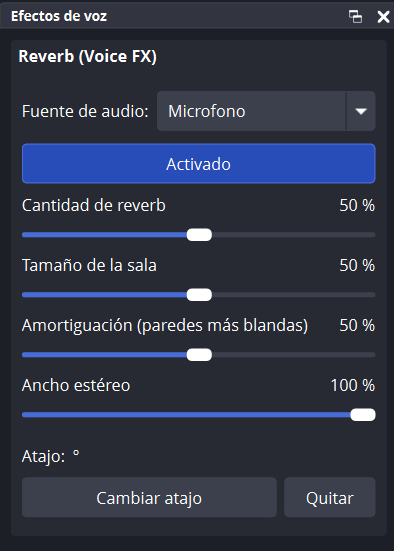

# OBS Voice FX

**English** | [Español](README.es.md)

An **OBS Studio** plugin that adds voice effects, starting with **reverb**. Each effect is turned on and off with a hotkey or from its own panel. The effect is heard **only in what OBS outputs** (stream and recording). Your microphone, Discord and the rest of your PC are not affected.

<p align="center">
  
</p>

## Features

- **Reverb** with amount, room size, damping and stereo width.
- **"Voice effects" panel** that docks in the OBS window like any other panel. From there you pick the audio source, turn the effect on or off, move the sliders and assign the hotkey.
- **Hotkey** to toggle each effect. It also shows up in OBS *Settings → Hotkeys*.
- **Your voice keeps its volume**: the effect is added *underneath* your voice; it never replaces or lowers it.
- **If anything fails, your voice still passes**: on any effect error, the plugin lets your original voice through. No silence, no noise.
- No internet connection and no telemetry.

## Requirements

| | |
|---|---|
| System | Windows 10 or 11, 64-bit |
| OBS Studio | 33.x (tested on **OBS 33.0.1**, Windows 11 64-bit) |

## Installation

> **Step-by-step PDF guide with screenshots:** [English](https://github.com/Aetther/obs-voice-fx/releases/latest/download/OBS-Voice-FX-Installation-Guide-EN.pdf) · [Español](https://github.com/Aetther/obs-voice-fx/releases/latest/download/OBS-Voice-FX-Guia-de-instalacion.pdf)

1. Download **`obs-voice-fx-0.1.0-windows-x64.zip`** from the repository [**Releases**](https://github.com/Aetther/obs-voice-fx/releases) page.
   > Don't use the green **Code → Download ZIP** button: that downloads the source code, not the ready-to-use plugin.
2. **Close OBS.**
3. Install it in one of these two ways.

### Option A: with one command (recommended)

Open **PowerShell as administrator**: right-click the Start button → *Terminal (Admin)*. Paste this command, which takes the zip from your **Downloads** folder and installs it into OBS:

```powershell
Expand-Archive -Force -Path "$env:USERPROFILE\Downloads\obs-voice-fx-0.1.0-windows-x64.zip" -DestinationPath "$env:ProgramData\obs-studio\plugins"
```

If you saved the zip somewhere else, replace the path after `-Path`. You can copy the file's path with Shift + right-click → *Copy as path*.

### Option B: with File Explorer

1. Open the zip and copy the **`obs-voice-fx`** folder inside it.
2. In the File Explorer address bar type `C:\ProgramData\obs-studio\plugins` and press Enter. If the `plugins` folder doesn't exist, create it.
3. Paste the folder there. Windows will ask for administrator permission: accept with *Continue*.

Either way, it must end up like this:

```
C:\ProgramData\obs-studio\plugins\obs-voice-fx\obs-voice-fx.dll
C:\ProgramData\obs-studio\plugins\obs-voice-fx\LICENSE
C:\ProgramData\obs-studio\plugins\obs-voice-fx\data\...
```

### Verify the download (optional)

Each release publishes the zip's **SHA-256** hash. To confirm the file you downloaded is the original:

```powershell
Get-FileHash "$env:USERPROFILE\Downloads\obs-voice-fx-0.1.0-windows-x64.zip"
```

The number shown must match the one in the release.

### Check that it's installed

Open OBS and look at **Tools → Plugin Manager**: **OBS Voice FX** should appear with its version.

## Usage

1. Open the panel from the **Docks → Voice effects** menu. Drag it wherever is comfortable.
2. In **Audio source**, choose your microphone.
3. Press **Disabled** to turn it on: it changes to **Enabled**.
4. Adjust the sliders while you talk.
5. Press **Change hotkey**, press the combination you want (for example `Ctrl + Shift + R`) and you're done.

### Panel options

| Option | What it does |
|---|---|
| **Audio source** | Source the effect is applied to. Only sources that produce sound are listed. Choosing another one **moves** the effect with the same settings. *(none)* removes it from every source. |
| **Enabled / Disabled** | Turns the effect on or off. Same as the eye icon in the source's **Filters** window. When off, your voice comes out exactly as without the plugin. |
| **Reverb amount** | How much echo is added to your voice. 0 % = none. For streaming, 15–30 % usually works well. Your voice always keeps the same volume. |
| **Room size** | How long the echo lasts: low = small room, high = large hall or church. |
| **Damping** | How much brightness the echo loses: high = warm (curtains, carpet), low = bright and metallic (tiled bathroom). |
| **Stereo width** | How wide the echo sounds between left and right. Your voice always stays centered. |
| **Hotkey** | The assigned key combination. **Change hotkey** waits for you to press a new one (Esc cancels) and **Clear** removes it. |

What you change in the panel also shows in the source's **Filters** window, and vice versa: it's the same filter (**Reverb (Voice FX)**). You can also add it by hand from *Filters → + → Reverb (Voice FX)*.

### Hotkeys

- The hotkey is the same one listed in **Settings → Hotkeys** as *"Reverb (Voice FX): toggle on/off"*. You can change it from either place.
- It turns the effect on or off on the chosen source.
- It works even with OBS minimized or while you're in a game. You can change that in *Settings → Advanced → Hotkey Focus Behavior*.
- It's saved separately from your scenes, so it works across all your scene collections and profiles.

> If you pick a combination already used by another OBS action, pressing it will trigger both.

### Who hears the effect?

- **Your stream and your recordings**: yes.
- **You**: no, unless you enable monitoring for the microphone in **Advanced Audio Properties** (*Monitoring Enabled*). Then you hear yourself with the effect, the same as your audience.
- **Discord, calls or other programs**: no. The effect only exists inside OBS.

### Advanced: effect only on stream or only on recording

OBS applies filters to the whole source, so to split the audio you use two sources for the same microphone, each on its own track:

1. Add **another** *Audio Input Capture* source with the **same microphone**. For example: "Mic with reverb" and "Clean mic".
2. In the panel, choose "Mic with reverb" as the effect's source.
3. In **Advanced Audio Properties → Tracks**, check only **Track 1** on "Mic with reverb" and only **Track 2** on "Clean mic".
4. In **Settings → Output**, set **Output Mode: Advanced** and choose:
   - **Streaming → Audio Track**: the track you want on stream.
   - **Recording → Audio Track**: the track you want in the recording.

Never check the same track on both sources, or your voice will be heard twice.

## Updating

Close OBS and run the same install command with the new zip (changing the version number). Your settings and hotkey are kept.

## Uninstalling

1. *(Recommended)* In the panel, choose **Audio source: (none)** to remove the filter from your scenes.
2. Close OBS.
3. Delete the folder `C:\ProgramData\obs-studio\plugins\obs-voice-fx`, or in PowerShell as administrator:
   ```powershell
   Remove-Item -Recurse -Force "$env:ProgramData\obs-studio\plugins\obs-voice-fx"
   ```
4. *(Optional)* To also delete the saved hotkey, remove `%APPDATA%\obs-studio\plugin_config\obs-voice-fx`.

## Troubleshooting

| Problem | Solution |
|---|---|
| *"Access denied"* when installing | PowerShell isn't running as administrator. |
| *"The file is being used by another process"* | OBS is open. Close it and run the command again. |
| The zip isn't found | Check the name and folder. If your Downloads folder is on OneDrive, use the file's real path. |
| Not listed under *Docks* or *Filters* | Check that the DLL is at `...\plugins\obs-voice-fx\obs-voice-fx.dll` and not inside a repeated `obs-voice-fx` folder. |
| The **Enabled** button is greyed out | Choose an **Audio source** first. |

To report a problem, open an [issue](https://github.com/Aetther/obs-voice-fx/issues) and attach your OBS log (*Help → Log Files → Upload Current Log File*). The plugin's lines start with `[obs-voice-fx]`.

## Security

- The plugin **doesn't connect to the internet** and collects no data.
- The only thing it writes on your PC is the hotkey file (`%APPDATA%\obs-studio\plugin_config\obs-voice-fx\hotkeys.json`), using OBS's safe save (temporary file + backup copy).
- Audio safeguards:
  - Slider values are always kept within their range, even if the settings file is damaged.
  - An invalid value from the effect is discarded and your original voice passes through.
  - The effect never pushes the audio above 0 dBFS.
- Built with warnings as errors and Windows protections enabled (Control Flow Guard, ASLR, DEP, CET).
- Every release is built from a published commit, so you can see the exact code of what you install.

## Building from source

Only needed if you want to modify the plugin. To use it, the zip from *Releases* is enough.

### Requirements

- Windows 10/11, 64-bit.
- **Visual Studio 2026 Build Tools** with the *Desktop development with C++* workload:
  ```powershell
  winget install --id Microsoft.VisualStudio.BuildTools --override "--wait --passive --add Microsoft.VisualStudio.Workload.VCTools --includeRecommended"
  ```
- **CMake** 3.25 or later: `winget install --id Kitware.CMake -e`
- **Git**: `winget install --id Git.Git -e`
- **OBS Studio 33.0.1** installed. The script uses its DLLs to generate the link libraries.

### Steps

```powershell
git clone https://github.com/Aetther/obs-voice-fx.git
cd obs-voice-fx

# 1. Dependencies: OBS 33.0.1 headers and Qt 6.11.1 (SHA-256 verified)
powershell -ExecutionPolicy Bypass -File scripts\preparar-deps.ps1

# 2. Configure, build and test
cmake -S . -B build -A x64
cmake --build build --config Release
ctest --test-dir build -C Release --output-on-failure

# 3. Put the ready plugin in release\obs-voice-fx
cmake --install build --config Release
```

To try it, copy `release\obs-voice-fx` into `C:\ProgramData\obs-studio\plugins\` (as administrator, with OBS closed).

`preparar-deps.ps1` puts everything in `deps\`, which is not committed, and does the following:
- checks your OBS version and digital signature;
- downloads only the public OBS headers at the exact 33.0.1 commit;
- downloads the official Qt package used by OBS and checks its SHA-256.

### Making a release

```powershell
powershell -ExecutionPolicy Bypass -File scripts\empaquetar.ps1
```

It requires no uncommitted changes. It builds, runs the tests and leaves in `out\` the zip, its `.sha256` and a separate zip with the debug symbols (`.pdb`).

### Project structure

```
obs-voice-fx/
├── CMakeLists.txt            Build
├── cmake/manifest.json.in    Plugin info for OBS (version)
├── data/locale/              English and Spanish texts
├── scripts/
│   ├── preparar-deps.ps1     Downloads and verifies dependencies
│   └── empaquetar.ps1        Builds the release zip
├── src/
│   ├── plugin-main.c         Plugin entry point
│   ├── core/                 OBS filter, hotkeys, safe mixing
│   ├── effects/              Effects (each in its own folder)
│   │   └── reverb/
│   └── ui/                   "Voice effects" panel (Qt)
└── tests/test-dsp.c          Audio processing tests
```

Each effect is a description (`vfx_effect_info`) with its parameters and audio functions. To add a new one:
1. Create its folder in `src/effects/`.
2. Add it to `src/effects/effects-list.c` and to `CMakeLists.txt`.
3. Add its texts in `data/locale/`.

The filter, the hotkey and its block in the panel are created automatically.

Code comments and script messages are in Spanish.

## License

Copyright (C) 2026 Gonzalo Alejandro Zalazar.

Distributed under the **GNU General Public License v2.0 or later** (GPL-2.0-or-later). See [LICENSE](LICENSE).
